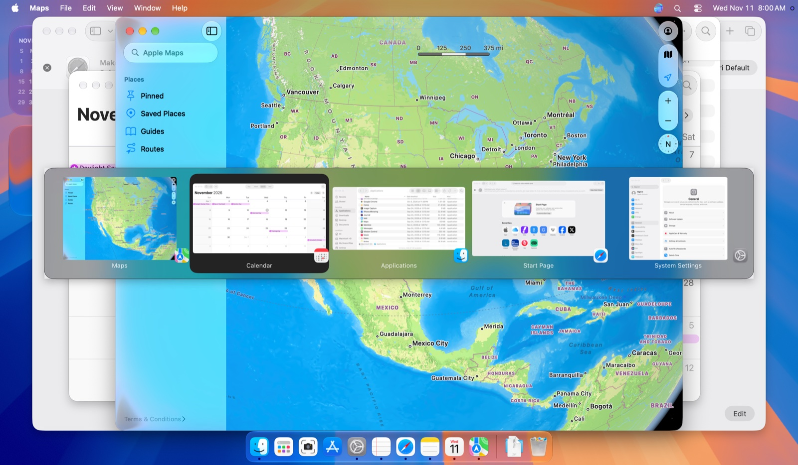

<div align="center">


# CmdTab

Cmd+Tab between windows, not apps, on macOS.

[](https://github.com/dinhanhthi/CmdTab/releases/latest)
[](LICENSE)

</div>

CmdTab is a small menu bar app that replaces the system Cmd+Tab with a switcher that lists windows, front to back, instead of one entry per app.



## Features

- One entry per window, with thumbnails, app icons and titles.
- A quick tap switches to the previous window at once.
- Tab / Shift+Tab, arrows or the mouse to pick; release to switch, Escape to cancel.
- Hotkey ⌘ Tab, ⌥ Tab or ⌃ Tab. Windows from the screen under the pointer or all screens.
- Themes, sizes, start at login, updates through Sparkle. Everything is in Settings.

## Requirements

- macOS 15 or later, Apple silicon. Tested on macOS 27 only.
- **Accessibility** (required) to list and focus windows.
- **Screen Recording** (optional) for thumbnails and titles; applies after a restart.

## If the native Cmd+Tab stops working

After a force quit, the system Cmd+Tab can stay off. Open CmdTab again and quit it normally (menu bar icon > Quit CmdTab).

## Known limitations

- Only windows on the current Space; minimized windows and hidden apps are skipped.
- No scrolling: windows that do not fit on the panel are not shown.
- CmdTab uses private APIs (`CGSSetSymbolicHotKeyEnabled`, `_AXUIElementGetWindow`, and SkyLight's `_SLPSSetFrontProcessWithOptions` and `SLPSPostEventRecordTo` to focus a window) that a macOS update may break.

## Build

Needs Xcode 27 and [XcodeGen](https://github.com/yonaskolb/XcodeGen).

```sh
xcodegen generate
xcodebuild -project CmdTab.xcodeproj -scheme CmdTab -configuration Debug build
```

Without the Developer ID certificate, add `CODE_SIGN_IDENTITY=- CODE_SIGN_STYLE=Automatic DEVELOPMENT_TEAM=`. More in [CONTRIBUTING.md](CONTRIBUTING.md); releases in [docs/RELEASING.md](docs/RELEASING.md).

## License

MIT, see [LICENSE](LICENSE).
